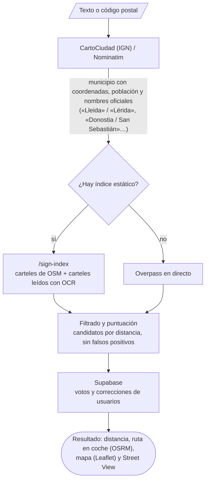
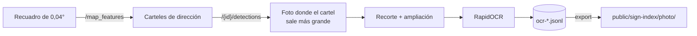
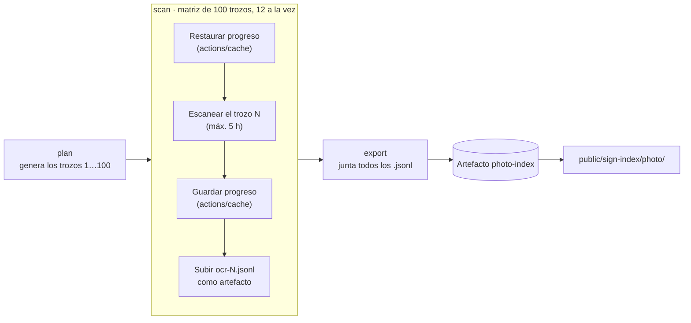

<p align="center">
  
</p>

**¿Hasta dónde llega el nombre de tu pueblo?** Buscas tu municipio y la web encuentra el cartel de carretera más lejano de España que lo menciona: a cuántos kilómetros está, por dónde se llega y cómo se ve en Street View.

La idea es sencilla, pero no existe ninguna base de datos pública con «lo que pone en cada cartel de carretera de España». Este README cuenta cómo la hemos construido: combinando OpenStreetMap con los carteles de toda España leídos con OCR a partir de las fotos de Mapillary, un escaneo que repartimos entre decenas de máquinas con GitHub Actions.

---

## Índice

1. [Cómo funciona una búsqueda](#cómo-funciona-una-búsqueda)
2. [De dónde salen los datos](#de-dónde-salen-los-datos)
   - [Fuente 1: OpenStreetMap](#fuente-1-openstreetmap)
   - [Fuente 2: fotos de Mapillary leídas con RapidOCR](#fuente-2-fotos-de-mapillary-leídas-con-rapidocr)
   - [Escanear toda España con GitHub Actions](#escanear-toda-españa-con-github-actions)
   - [Fuente 3: lo que aportan los usuarios](#fuente-3-lo-que-aportan-los-usuarios)
3. [El índice estático](#el-índice-estático)
4. [Cómo se elige el cartel ganador](#cómo-se-elige-el-cartel-ganador)
5. [Historia del proyecto](#historia-del-proyecto)
6. [Puesta en marcha](#puesta-en-marcha)
7. [Estructura del repositorio](#estructura-del-repositorio)
8. [Servicios externos y créditos](#servicios-externos-y-créditos)

---

## Cómo funciona una búsqueda



Todo ocurre en el navegador: la web es estática (React + Vite + Tailwind) y el trabajo pesado —procesar OSM y leer miles de fotos— se hace antes, con scripts de Python, y se publica como ficheros JSON.

---

## De dónde salen los datos

### Fuente 1: OpenStreetMap

[`scripts/build_sign_index.py`](HowFarHome/scripts/build_sign_index.py) recorre con `pyosmium` el extracto completo de España de Geofabrik (`spain-latest.osm.pbf`) y se queda solo con lo que sirve para la búsqueda:

| Qué se extrae | Para qué | Cantidad |
|---|---|---|
| Vías con etiqueta `destination` / `destination:forward` / `destination:backward` | Es la transcripción de lo que pone el cartel en ese ramal | 34 276 |
| Nodos con `destination` | Carteles mapeados como punto | 690 |
| Carreteras llamadas «Carretera de X a Y» | Si una carretera lleva a un pueblo, su otro extremo suele tener un cartel con ese nombre | 71 453 |
| Núcleos de población (`city`, `town`, `village`, `hamlet`) | Saber dónde está cada sitio y su población | 66 664 |

También genera alias: «La Roda de Andalucía» aparece en los carteles como «La Roda», y «Sevilla la Nueva» no debe confundirse con Sevilla.

**El problema:** OSM solo tiene la etiqueta `destination` en una parte pequeña de los cruces de España. Muchos carteles reales no están mapeados, y para pueblos pequeños el resultado se quedaba corto. Había que leer los carteles de verdad.

### Fuente 2: fotos de Mapillary leídas con RapidOCR

[Mapillary](https://www.mapillary.com) tiene millones de fotos a pie de calle y, sobre ellas, detecta automáticamente señales de tráfico y las sitúa en el mapa. Lo que **no** hace es leer el texto de los carteles. Eso lo hace [`scripts/scan_mapillary_signs.py`](HowFarHome/scripts/scan_mapillary_signs.py):

1. **Listar carteles de dirección.** Divide la zona en recuadros de 0,04° y pide a la API Graph de Mapillary (`/map_features`) las señales de cada uno. Se queda con los tipos que llevan nombres de destino: `information--general-directions`, `information--directions`, `information--highway-exit`, `information--motorway-exit-ahead`, `complementary--texts`…
2. **Elegir la mejor foto.** Para cada cartel pide sus detecciones (`/{id}/detections`), decodifica la geometría (un tile vectorial en base64) y escoge la foto en la que el cartel sale más grande.
3. **Recortar.** Descarga la miniatura de 2048 px —o la original si el cartel queda diminuto—, recorta el cartel con un 15 % de margen y lo amplía hasta al menos 400 px de ancho.
4. **Leer con [RapidOCR](https://github.com/RapidAI/RapidOCR).** Modelos PaddleOCR sobre ONNX Runtime: funciona en CPU, sin GPU, y lee bien los textos de los carteles españoles. Las descargas van por delante del OCR en un pool de hilos, así que mientras se lee un cartel ya se están bajando los siguientes (~2,6 s por cartel).
5. **Guardar al momento.** Cada resultado se añade a `data/mapillary/ocr-<zona>.jsonl` en cuanto se lee: se puede cortar en cualquier momento y al relanzar sigue donde iba.

```json
{"id": "466337014473079", "lat": 37.37178, "lng": -3.07164,
 "value": "information--general-directions--g1",
 "text": "HERNÁN VALLE", "image": "780279692691408"}
```

6. **Exportar.** `export` junta todos los `.jsonl`, quita duplicados y escribe `public/sign-index/photo/`, indexado por cada palabra del texto (de 4 letras o más). La web carga solo los ficheros de las palabras del municipio buscado.



El método se afinó primero en una zona pequeña entre Jódar, Úbeda, Peal de Becerro y Cazorla, y luego en toda la provincia de Jaén (676 carteles de dirección, 302 con texto legible). Con el proceso ya probado, se lanzó sobre toda España.

#### Lo que aprendimos de la API de Mapillary

Varias decisiones del script salen de pelearse con la API:

- **Error 500 con recuadros grandes.** Con 0,09° de lado la API responde 500; con 0,05° funciona. Se usan 0,04°, y si aun así falla o devuelve el máximo de 2000 señales, el recuadro se divide en cuatro (hasta ~500 m de lado).
- **Bordes «redondos» que devuelven cero.** Un recuadro con bordes en valores exactos (`-3.36, 37.89`) devolvía 0 resultados aunque tuviera señales; desplazado una milésima, sí. Por eso la cuadrícula se desplaza 0,00037° y los recuadros se solapan un poco (los repetidos se quitan por id).
- **Demasiadas peticiones a la vez.** Con más de ~12 máquinas en paralelo Mapillary empieza a responder con errores 500. Los 429/5xx se reintentan con espera exponencial.

### Escanear toda España con GitHub Actions

España son **52 069 recuadros**. A 2,6 s por cartel en un único PC habrían sido días de ejecución, así que el escaneo de todo el país se repartió entre muchas máquinas de GitHub con el workflow [`.github/workflows/scan-spain.yml`](.github/workflows/scan-spain.yml).



- **Cobertura de España sin mar.** Los recuadros salen de las cajas de las 17 comunidades autónomas más Ceuta y Melilla, con una cuadrícula de origen común para que las fronteras entre comunidades no generen recuadros repetidos.
- **Trozos salteados.** El trozo 3 de 100 coge los recuadros 3, 103, 203… Así cada máquina recibe un poco de ciudad (muchos carteles) y un poco de campo, y todas tardan parecido.
- **Presupuesto de tiempo.** GitHub corta las tareas a las 6 h. Con `SCAN_BUDGET_MIN=300` el script se para ordenadamente a las 5 h y guarda lo hecho.
- **Reanudable.** El progreso de cada trozo (recuadros listados, carteles leídos) se guarda en `actions/cache`. Si un trozo no acaba, se relanza el workflow con la misma `version` y sigue donde iba; los trozos ya terminados acaban en un minuto. Cambiar `version` empieza de cero.
- **Tolerante a fallos.** `fail-fast: false`: si un trozo falla, los demás siguen y `export` se ejecuta igualmente con lo leído.
- **Resumen.** Al terminar, el resumen de la ejecución dice cuántos trozos están completos y cuántos carteles se han leído. El artefacto `photo-index` se descomprime en `HowFarHome/public/sign-index/photo/`.

Así se escaneó España entera, y así se vuelve a escanear cuando Mapillary tiene fotos nuevas: **Actions → Escanear carteles de España → Run workflow**. Necesita el secreto `MAPILLARY_TOKEN` en el repositorio (Settings → Secrets and variables → Actions) con un Client Token de Mapillary (empieza por `MLY|`).

| Entrada | Por defecto | Qué hace |
|---|---|---|
| `shards` | `100` | Trozos en que se divide España. No lo cambies entre relanzamientos. |
| `parallel` | `12` | Trozos a la vez. Con más, Mapillary devuelve errores 500. |
| `version` | `v1` | Nombre del progreso guardado. Cámbialo para empezar de cero. |

### Fuente 3: lo que aportan los usuarios

Sin necesidad de cuenta, cualquiera puede:

- votar si un cartel candidato existe de verdad («sí hay cartel / no hay cartel»),
- añadir un cartel que falta o mover uno que está mal situado (como mucho 2 km).

Se guarda en [Supabase](https://supabase.com) (tablas en [`supabase/`](HowFarHome/supabase)), con políticas RLS que permiten leer y añadir pero no editar ni borrar. Sin Supabase configurado, los votos se guardan solo en el navegador.

---

## El índice estático

Para no depender de Overpass en cada búsqueda (lento y con límites de uso), los datos se publican como ficheros JSON en `public/sign-index/`, repartidos por las **dos primeras letras** de la clave normalizada (sin tildes, en minúsculas): `ja.json`, `ca.json`, `_a.json`… Buscar «Jódar» descarga solo `jo.json`, y no los ~49 MB del índice completo.

```
public/sign-index/
├── meta.json          # fecha de generación y recuentos de OSM
├── ja.json, ca.json…  # 332 trozos de OSM, por nombre de destino
└── photo/
    ├── meta.json      # carteles leídos con OCR
    └── he.json, va.json…   # carteles de Mapillary, por palabra del texto leído
```

Si el índice no existe (por ejemplo, en un clon recién hecho), la web consulta Overpass en directo.

---

## Cómo se elige el cartel ganador

Encontrar el nombre en un cartel es fácil; que no sea un falso positivo, no tanto. [`src/services/signs.js`](HowFarHome/src/services/signs.js) aplica estas reglas:

- **Nombre completo.** «Parque Natural de Cazorla» no es un cartel de Cazorla, y «Sevilla la Nueva» no lleva a Sevilla.
- **Alcance según población.** Un pueblo pequeño solo aparece en los carteles de su comarca; una ciudad, en toda España. Un cartel a 400 km que nombra una aldea de 200 habitantes es casi seguro otra aldea con el mismo nombre.
- **Ruido del OCR.** Se descartan las referencias de carretera y distancias que se cuelan entre palabras (`PEAL | 25 | DE | BECERRO`), los nombres de sierras (`P.N. Sierras de Cazorla`, también mal leídas como «Slerras») y los paneles de obras y subvenciones («Consejería…», «Unión Europea»), que citan pueblos pero no indican el camino.
- **Tolerancia a errores.** En nombres largos se admite un error de OCR; en los cortos no, porque «centro» acabaría siendo «Cenero».
- **Agrupación.** Carteles a menos de 1,5 km son el mismo cruce; otros carteles cercanos con el mismo nombre refuerzan al candidato.
- **Votos.** Los votos de los usuarios suben o bajan cada candidato.

Para el ganador se calcula la ruta en coche con OSRM y se busca la foto de Street View un poco antes del desvío, mirando hacia el cartel.

---

## Historia del proyecto

1. **Frontend y servicios base.** React + Vite + Tailwind, geolocalización, distancia, rutas con OSRM y Street View (incluido un visor que no necesita clave de Google).
2. **Consultas a Overpass en directo.** La primera versión preguntaba a Overpass por los carteles en cada búsqueda: funcionaba, pero era lenta y se topaba con los límites del servicio.
3. **Índice propio a partir de OSM.** `build_sign_index.py` procesa el `.pbf` de España una vez y genera el índice estático repartido por letras.
4. **Búsqueda por código postal y municipios homónimos.** CartoCiudad para autocompletar y elegir entre pueblos con el mismo nombre.
5. **Aportaciones de usuarios.** Añadir carteles y corregir su posición sin iniciar sesión, con Supabase.
6. **OCR de Mapillary.** Prueba en Jódar–Cazorla y escaneo completo de la provincia de Jaén con RapidOCR.
7. **Escaneo de toda España con GitHub Actions.** El workflow en matriz, varias rondas de ajustes contra los errores 500 de Mapillary (recuadros más pequeños, división automática, menos paralelismo) y el índice de fotos de todo el país incorporado a la web.
8. **Interfaz nueva y textos legales.** Aviso legal, privacidad, cookies, créditos y FAQ.

---

## Puesta en marcha

Requisitos: Node.js 20+ y, para regenerar los datos, Python 3.13.

```bash
cd HowFarHome
npm install
cp .env.example .env.local   # todo es opcional; ver los comentarios del fichero
npm run dev
```

### Variables de entorno (`.env.local`)

| Variable | Uso |
|---|---|
| `VITE_SUPABASE_URL`, `VITE_SUPABASE_KEY` | Votos y aportaciones compartidos. Crea las tablas con `supabase/*.sql`. |
| `VITE_MAPILLARY_TOKEN` | Solo para ejecutar el escáner en local; la web no lo usa. |
| `VITE_GOOGLE_MAPS_API_KEY` | Opcional: Street View por la vía oficial. |
| `VITE_SITE_URL` | Dominio público para canonical, Open Graph, sitemap y robots.txt. |
| `VITE_ADSENSE_CLIENT`, `VITE_ADSENSE_SLOT` | Opcional: publicidad. Sin ellas no se carga nada. |

### Regenerar los datos

```bash
cd HowFarHome
python -m venv data/.venv
data/.venv/Scripts/pip install osmium -r scripts/requirements-scan.txt
```

Índice de OpenStreetMap (descarga antes `spain-latest.osm.pbf` de [Geofabrik](https://download.geofabrik.de/europe/spain.html) en `data/osm/`):

```bash
data/.venv/Scripts/python scripts/build_sign_index.py data/osm/spain-latest.osm.pbf
```

Carteles de Mapillary, en local para una zona:

```bash
data/.venv/Scripts/python scripts/scan_mapillary_signs.py scan jaen
```

Un trozo de España, como lo hace GitHub Actions:

```bash
data/.venv/Scripts/python scripts/scan_mapillary_signs.py scan spain 3/100
```

Generar `public/sign-index/photo/` con todo lo leído:

```bash
data/.venv/Scripts/python scripts/scan_mapillary_signs.py export
```

---

## Estructura del repositorio

```
.github/workflows/scan-spain.yml   Escaneo de España en paralelo
HowFarHome/
├── scripts/
│   ├── build_sign_index.py        OSM (.pbf) → public/sign-index/
│   ├── scan_mapillary_signs.py    Mapillary + RapidOCR → public/sign-index/photo/
│   └── requirements-scan.txt
├── public/sign-index/             Índice estático que consume la web
├── src/
│   ├── screens/                   Landing, elegir sitio, carga, resultado
│   ├── components/                Mapa, Street View, candidatos, editor de carteles…
│   ├── services/                  Búsqueda, índice, OSM, geocodificación, rutas, votos
│   └── legal/                     Aviso legal, privacidad, cookies, créditos
├── supabase/                      Esquema de votos y aportaciones
└── data/                          Datos de trabajo (no se publican)
```

---

## Servicios externos y créditos

- **[OpenStreetMap](https://www.openstreetmap.org/copyright)** — carteles, carreteras y núcleos de población. © colaboradores de OpenStreetMap, licencia ODbL. Extracto de [Geofabrik](https://www.geofabrik.de).
- **[Mapillary](https://www.mapillary.com)** — fotos a pie de calle y detección de señales, vía API Graph. Imágenes bajo CC BY-SA.
- **[RapidOCR](https://github.com/RapidAI/RapidOCR)** — lectura del texto de los carteles (modelos PaddleOCR en ONNX Runtime).
- **[GitHub Actions](https://docs.github.com/actions)** — escaneo distribuido de España.
- **[CartoCiudad (IGN)](https://www.cartociudad.es)** y **[Nominatim](https://nominatim.org)** — búsqueda de municipios y códigos postales.
- **[OSRM](https://project-osrm.org)** — distancia y tiempo por carretera.
- **Google Street View** — imagen del cartel.
- **[Supabase](https://supabase.com)** — votos y aportaciones de usuarios.
- **[Leaflet](https://leafletjs.com)** — mapas.
